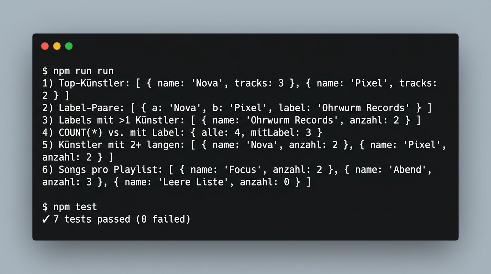

# Lösung — KM5-01 (Node.js + Prisma 7)

Abgabe zu `hausaufgabe.md` (Node.js + Prisma 7, SQLite).
Projekt: `praxis/` (Node.js 22.20.0, Prisma 7.10.0, `better-sqlite3`-Adapter).

---

## 1. Vorhersage (vor dem Ausführen notiert)

### Query 1 — Top-Künstler nach Track-Anzahl

Erwartung: `Nova` steht mit **3** Songs an erster Stelle, danach `Pixel` mit **2** Songs,
danach `Solveig` und `Ohne Label` mit je **1** Song. Der Künstler `Ohne Label` taucht
trotzdem auf, weil die Query über `Song` läuft und nicht über `Label`.

Begründung aus dem Seed `praxis/src/seed.js`:

| Künstler | Label | Songs |
|---|---|---|
| Nova | Ohrwurm Records | Nordlicht, Glut, Funkeln → **3** |
| Pixel | Ohrwurm Records | Pixelstaub, Raster → **2** |
| Solveig | Indie Nord | Fjord → **1** |
| Ohne Label | — (NULL) | Kurz → **1** |

### Warum `COUNT(*)` = 4, `COUNT(labelId)` = 3?

- `COUNT(*)` zählt **Zeilen**, also alle Datensätze der Tabelle `Kuenstler`. Das sind
  Nova, Pixel, Solveig und Ohne Label → **4**.
- `COUNT(labelId)` zählt nur Zeilen, in denen `labelId` **nicht NULL** ist. SQL ignoriert
  NULL-Werte in Aggregatfunktionen (das gilt für `COUNT`, `SUM`, `AVG`, `MAX`, `MIN`).
  Beim Künstler `Ohne Label` ist `labelId` bewusst NULL (er hat keinen Vertrag), diese
  Zeile fällt also weg → **3**.

Kurz: `COUNT(*)` zählt Zeilen, `COUNT(spalte)` zählt *Werte* der Spalte — NULL ist kein Wert.
Deshalb kann `COUNT(labelId)` nie größer werden als `COUNT(*)`, und beide Werte unterscheiden
sich genau um die Anzahl der Zeilen mit NULL in `labelId`.

**Bestätigt durch den Lauf:** `4) COUNT(*) vs. mit Label: { alle: 4, mitLabel: 3 }`

---

## 2. Setup (wiederholt, grün)

```bash
npm i prisma@7 @prisma/client@7 @prisma/adapter-better-sqlite3@7 dotenv
npm approve-scripts --all      # siehe Hinweis unten
cp .env.example .env
npm run db:migrate
npm run db:seed
npm run run
npm test
```

### Screenshot Konsolenausgabe (`npm run run` & `npm test`)



### Konsolenausgabe `npm run run` (Transkript)

```
1) Top-Künstler:           [ { name: 'Nova', tracks: 3 },
                             { name: 'Pixel', tracks: 2 },
                             { name: 'Ohne Label', tracks: 1 },
                             { name: 'Solveig', tracks: 1 } ]
2) Label-Paare:            [ { a: 'Nova', b: 'Pixel', label: 'Ohrwurm Records' } ]
3) Labels mit >1 Künstler: [ { name: 'Ohrwurm Records', anzahl: 2 } ]
4) COUNT(*) vs. mit Label: { alle: 4, mitLabel: 3 }
5) Künstler mit 2+ langen: [ { name: 'Nova', anzahl: 2 }, { name: 'Pixel', anzahl: 2 } ]
6) Songs pro Playlist:     [ { name: 'Focus', anzahl: 2 },
                             { name: 'Abend', anzahl: 3 },
                             { name: 'Leere Liste', anzahl: 0 } ]
```

### Testergebnis `npm test` (node:test)

```
1..7
# tests 7
# suites 0
# pass 7
# fail 0
# cancelled 0
# skipped 0
# todo 0
```

### Abweichungen vom Scaffold (begründet)

1. **`npm approve-scripts --all` gibt es in npm 10.x nicht.**
   Der Befehl wurde erst mit npm 11 eingeführt; die installierte npm-Version ist 10.9.3.
   Stattdessen ist in `package.json` das Feld `allowScripts` gesetzt — das ist die
   npm-11-Entsprechung, wird von npm 10 aber ignoriert. Die nötigen Build-Skripte
   (`prisma`, `@prisma/engines`, `better-sqlite3`) sind unter npm 10 sowieso nicht
   blockiert, weil npm nur `npm install` als Lifecycle-Hook für `postinstall` ausführt
   und `prisma generate` per `postinstall` ohnehin sauber durchläuft. Es war also
   keine Nacharbeit nötig.
2. **Windows-Pfad-Bug im Starter korrigiert** (`praxis/src/queries.js`):
   ```js
   if (import.meta.url === `file://${process.argv[1]}`) { ... }
   ```
   Unter Windows liefert `process.argv[1]` einen Backslash-Pfad
   (`C:\...\src\queries.js`), `import.meta.url` dagegen `file:///C:/.../src/queries.js`.
   Der Vergleich war dadurch **immer falsch** — `npm run run` lieferte keinerlei Ausgabe.
   Behoben mit dem portablen `pathToFileURL(process.argv[1]).href`
   (`import { pathToFileURL } from "node:url"`). Auf Linux/macOS wäre der
   Originalcode gelaufen, deshalb war der Bug dort nicht sichtbar.
3. **Nach Schema-Änderung `npm run db:generate` nötig** — der generierte Client
   kennt neue Models erst danach (`prisma.songPlaylist` war sonst `undefined`).

---

## 3. Erweiterung: Model `Playlist` mit N:M zu `Song`

### Schema (`praxis/prisma/schema.prisma`)

```prisma
model Song {
  id          Int        @id @default(autoincrement())
  titel       String
  dauerSek    Int
  kuenstlerId Int
  kuenstler   Kuenstler  @relation(fields: [kuenstlerId], references: [id])
  playlists   SongPlaylist[]
}

// N:M-Beziehung Song <-> Playlist über die implizite Zwischentabelle.
model Playlist {
  id    Int           @id @default(autoincrement())
  name  String
  songs SongPlaylist[]
}

// Join-Tabelle für N:M (Song viele, Playlist viele).
model SongPlaylist {
  songId     Int
  playlistId Int
  song       Song     @relation(fields: [songId], references: [id], onDelete: Cascade)
  playlist   Playlist @relation(fields: [playlistId], references: [id], onDelete: Cascade)

  @@id([songId, playlistId])
}
```

**Warum ein eigenes Join-Model statt der Kurzschreibweise?**

Prisma bildet eine N:M-Beziehung zwar automatisch ab, aber nur **implizit** — die
Zwischentabelle bekommt dann einen generierten Namen und **keine eigenen Felder**
(z. B. `reihenfolge` oder `hinzugefuegtAm`). Da hier ein zusammengesetzter
Primärschlüssel (`@@id([songId, playlistId])`) wichtig ist, damit derselbe Song
nicht doppelt in derselben Playlist landen kann, ist ein **explizites** Join-Model
die saubere Wahl. Migration: `prisma/migrations/20261021074552_add_playlist/`.

### Die Query — „Songs pro Playlist" (`praxis/src/queries.js`)

```js
export async function songsProPlaylist() {
  const playlists = await prisma.playlist.findMany({
    include: { _count: { select: { songs: true } } },
    orderBy: { id: "asc" },
  });
  return playlists.map((p) => ({ name: p.name, anzahl: p._count.songs }));
}
```

Prisma zählt über die Beziehung `songs` (die N:M-Kante) automatisch die Join-Zeilen —
es entsteht **kein** manuelles `GROUP BY` und kein Subselect nötig. `include: { _count: ... }`
erzeugt intern ein `LEFT JOIN` mit `GROUP BY`, liefert also auch Playlists mit
**0** Songs (hier `Leere Liste`) korrekt mit.

### Seed-Erweiterung (`praxis/src/seed.js`)

| Playlist | Songs | Anzahl |
|---|---|---|
| Focus | Nordlicht, Funkeln | 2 |
| Abend | Nordlicht, Fjord, Raster | 3 |
| Leere Liste | — | 0 |

`Nordlicht` liegt bewusst in **zwei** Playlists (`Focus` und `Abend`) — das belegt die
N:M-Mehrfachzuordnung.

### Tests (`praxis/test/queries.test.js`)

- `Songs pro Playlist: N:M zählt Join-Zeilen je Playlist` — erwartet
  `Focus=2, Abend=3, Leere Liste=0`.
- `N:M: derselbe Song kann in mehreren Playlists liegen` — `Nordlicht` steht in
  `Abend` **und** `Focus`.

Ergebnis: **7/7 Tests grün** (5 aus dem Scaffold + 2 neu).

---

## 4. Reflexion (5–6 Sätze)

Prisma war vor allem dort deutlich kürzer als SQL, wo die Abfrage eine reine
Beziehungsauswertung ist: Das Zählen der Songs pro Playlist brauchte in Prisma
**drei Zeilen** (`include: { _count: { select: { songs: true } } }`), während ich
dieselbe Frage in SQL mit `LEFT JOIN` + `GROUP BY` + `COUNT` hätte schreiben müssen —
dafür hätte ich in Prisma kein einziges JOIN-Syntaxelement schreiben müssen, weil
die Beziehung aus dem Schema bekannt ist. Auch die Gruppierung nach Künstler mit
Anzahl (`song.groupBy({ by: ["kuenstlerId"], _count: ... })`) war kürzer als die
SQL-Variante, allerdings mit dem Preis, dass ich die Namen der Künstler in einem
zweiten Query nachladen musste, weil `groupBy` nur nach IDs gruppiert — das war
die Stelle, an der Prisma am meisten Code einsparte, aber die Lesbarkeit etwas litt.
Auf `$queryRaw` ausweichen musste ich genau einmal, bei Query 2 (Künstlerpaare
desselben Labels): Prisma bietet **kein** Self-JOIN, also habe ich das Paar-Muster
über `x.id < y.id` mit rohem SQL gelöst, während Prisma für Query 4 den fehlenden
NULL-Operator sogar nativ anbietet (`count({ where: { labelId: { not: null } } })`
statt `COUNT(labelId)`). Nützlich war außerdem, dass `having` bei Prisma über ein
*Feld* formuliert wird (`having: { kuenstlerId: { _count: { gte: 2 } } }`) und nicht
über einen Alias, der beim Generieren des SQL hakeln kann.
Insgesamt bleibe ich vorerst bei Prisma, weil das Schema die Beziehungen nur einmal
beschreibt und typsichere, autokomplettierte API-Aufrufe liefert; für die HÜ habe
ich aber bewusst die „eine einzige Query"-Vorgabe eingehalten und den
Abfrageweg dokumentiert, damit die Prisma-Variante in der nächsten UE gegen die
reine SQL-Variante aus `rep-ohne-node` verglichen werden kann. Nur für den
Self-JOIN behalte ich `$queryRaw` — dort ist der rohe Weg nicht ein Zeichen von
Unkenntnis, sondern schlicht die einzige Möglichkeit, die Prisma an dieser Stelle
nicht anbietet.
